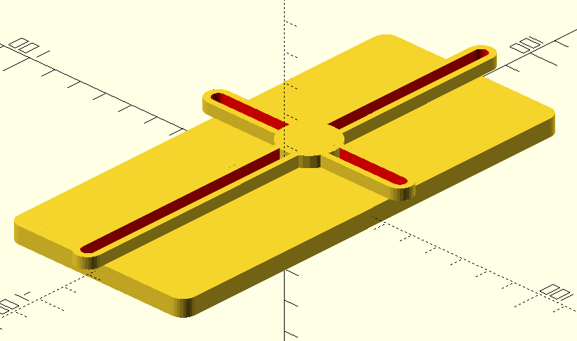
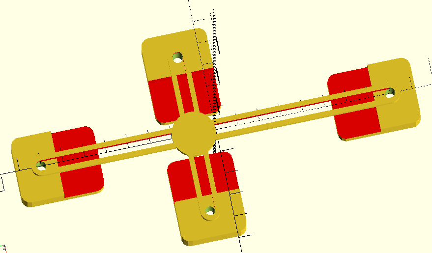

# Цифровой окуляр микроскопа

Модель в фомате OpenScad для печати на 3D-принтере.

# Ссылки

1. [Universal Phone Microscope Adapter](https://www.thingiverse.com/thing:431168) проект в сервисе thingiverse
